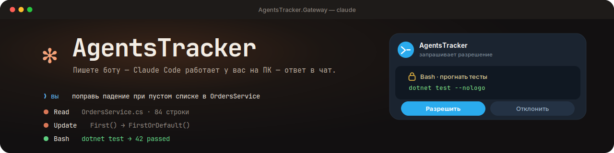
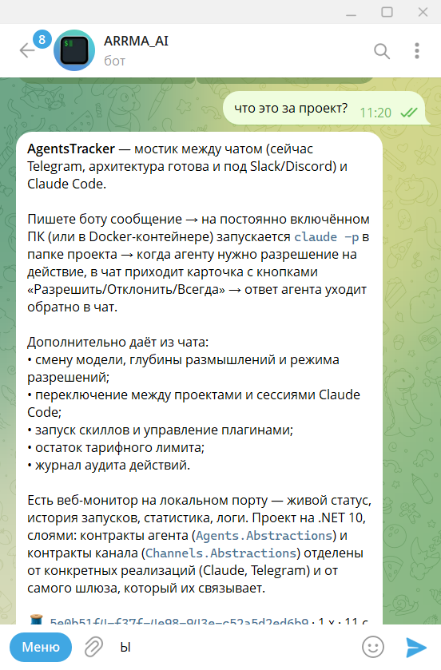
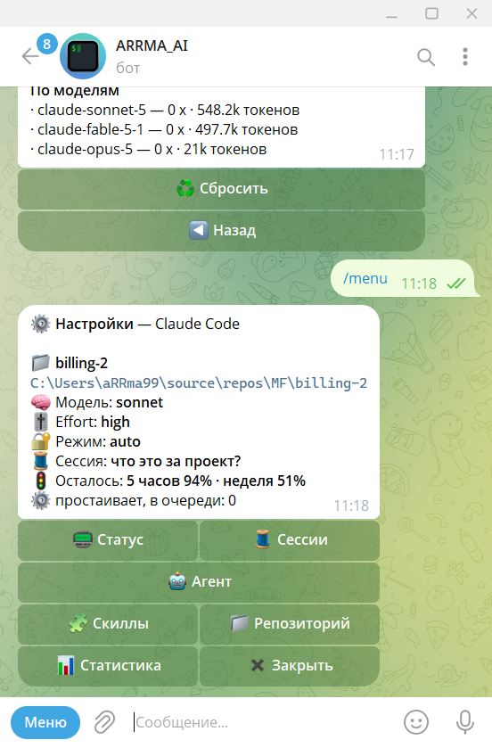
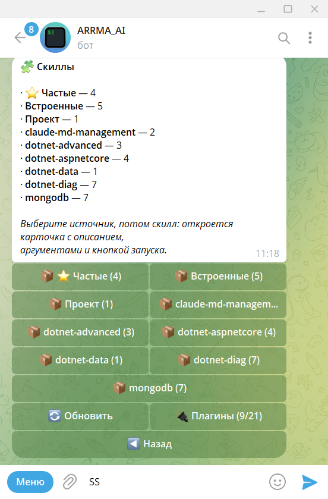
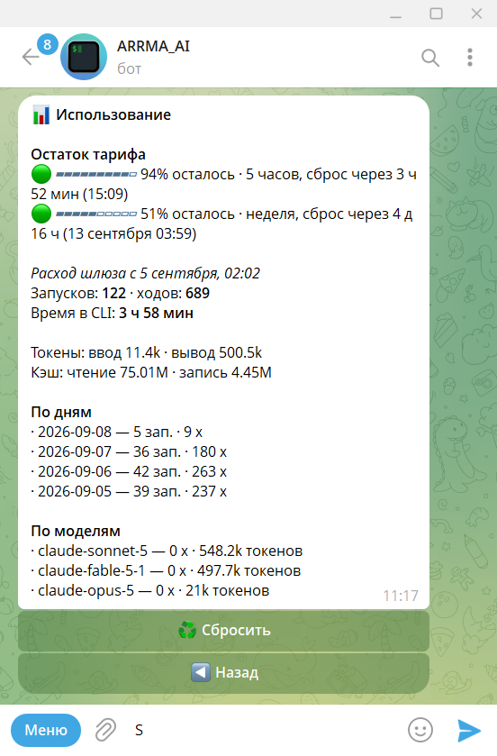
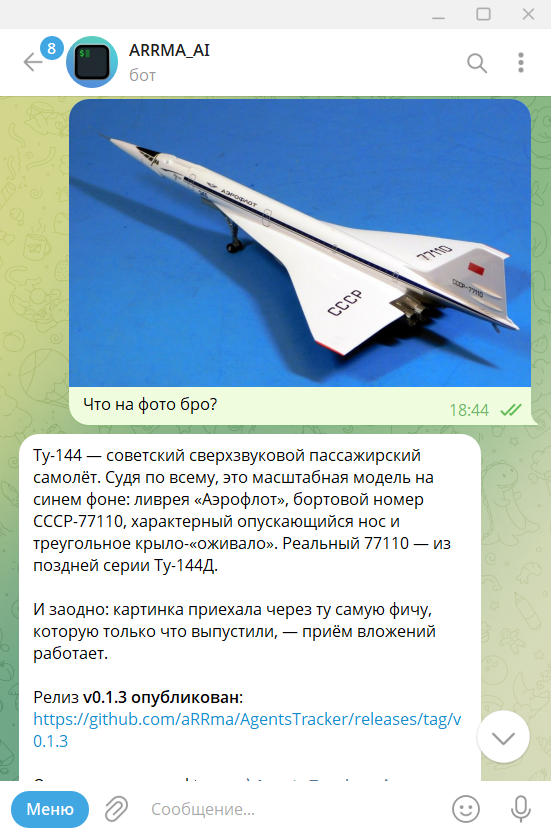
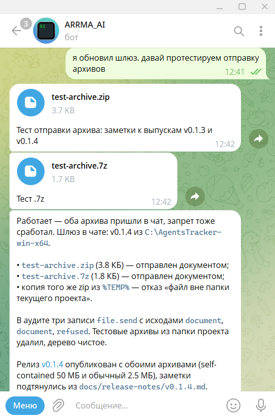
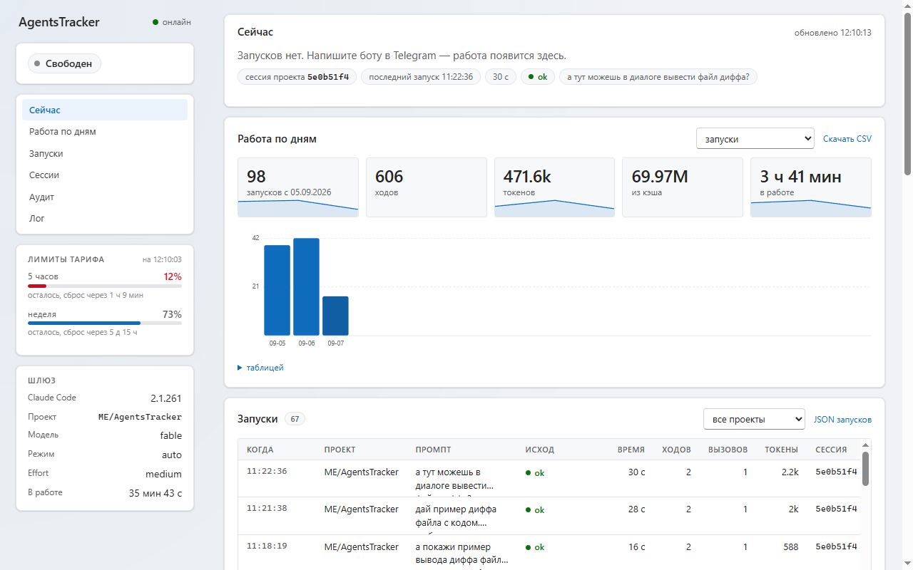
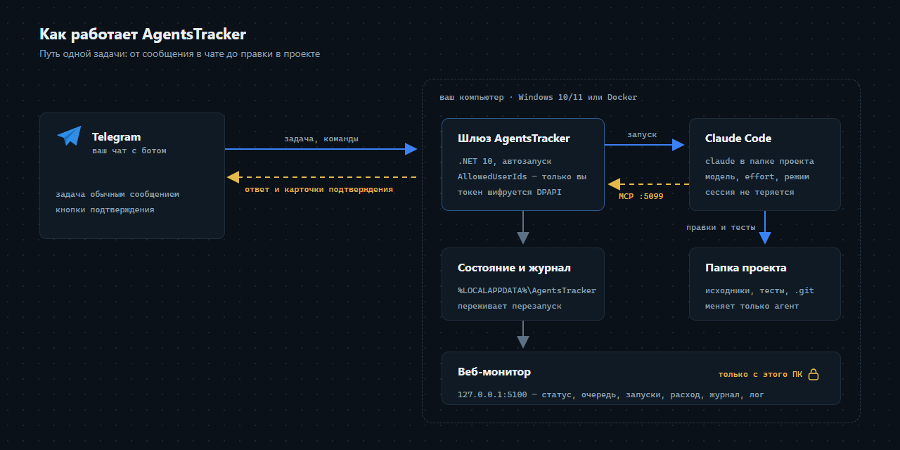

<h1 align="center">AgentsTracker</h1>

<p align="center">
  
</p>

<p align="center">
  Telegram-бот, через который вы ставите задачи Claude Code на своём компьютере.<br>
  Пишете боту — на ПК запускается <code>claude</code> в папке проекта — ответ приходит в чат.
</p>

<p align="center">
  
  
  
  
</p>

Каждое опасное действие агент подтверждает у вас кнопкой. Сессия не теряется между сообщениями и
перезапусками. Отчёт, разбор или скриншот агент присылает файлом в тот же чат.

Компьютер должен быть включён, а вы — войти в Windows: шлюз стартует при входе и берёт вход в
Claude Code из вашего профиля. Белый IP и открытые порты не нужны.

Агент видит всё, что видит ваша учётная запись Windows, а не только папку проекта. Отгородить его
можно только в [Docker](#docker). Как закрыть остальные риски — [docs/safety.md](docs/safety.md).

## Как это выглядит

**Задача — обычным сообщением:**

> **Вы:** поправь падение при пустом списке в `OrdersService` и запусти тесты
>
> **Бот:** 🕐 Работаю… 42 с · 🧵 5e0b51f4 · 🌿 master
> 🔧 3 вызова
> ▸ Read OrdersService.cs
> ▸ Edit OrdersService.cs
> ▸ Bash dotnet test --nologo
>
> **Бот:** 🔐 **Bash** — выполнить команду
> `dotnet test --nologo`
> *Запустить тесты*
> *Кнопка «Всегда» больше не спросит про: Bash(dotnet test --nologo)*
> `[ ✅ Разрешить ]  [ ♾ Всегда ]  [ ❌ Отклонить ]  [ ✋ Отклонить с причиной ]`
>
> **Бот:** Причина — `First()` на пустой коллекции. Заменил на `FirstOrDefault` с проверкой,
> тесты зелёные: 42 passed.
>
> 🧵 `5e0b51f4-f37f-4e98-943e-c52a5d2ed6b9` · 🌿 `master` · opus-5-5(H) · 4 х · 1 мин 5 с · 🧊 кэш до 15:42

**Живой чат:**

<table align="center">
  <tr>
    <td align="center" width="50%"><br><sub><b>Задача и ответ.</b> Спросили — агент прочитал проект и ответил</sub></td>
    <td align="center" width="50%"><br><sub><b><code>/menu</code>.</b> Проект, модель, effort, режим и сессия — кнопками</sub></td>
  </tr>
  <tr>
    <td align="center" width="50%"><br><sub><b><code>/skills</code>.</b> Скиллы по источникам и плагины Claude Code</sub></td>
    <td align="center" width="50%"><br><sub><b><code>/usage</code>.</b> Лимиты тарифа, расход по дням и моделям</sub></td>
  </tr>
  <tr>
    <td align="center" width="50%"><br><sub><b>Картинка в чат.</b> Прислали фото с подписью — агент посмотрел и ответил</sub></td>
    <td align="center" width="50%"><br><sub><b>Файлы из проекта.</b> Агент присылает отчёт или набор файлов архивом</sub></td>
  </tr>
</table>

## Не только код

Домашний компьютер знает про вас больше телефона: там документы, фотографии, выписки и заметки.
Обычно до них можно дотянуться, только сев за стол.

| Что спрашивают | Пример сообщения |
|---|---|
| **Забытый файл** — найти дома и прислать в чат, хоть по имени, хоть по тому, что внутри | «Найди скан загранпаспорта в Документах и пришли сюда» |
| **Домашняя бухгалтерия** — выписки, чеки и счётчики сводятся сами | «Сведи траты за квартал по категориям и пришли файлом» |
| **Заметки** — записать, найти в архиве, подвести итог недели | «Что я записывал про ремонт балкона?» |
| **Как дела дома** — место на диске, долгая выгрузка, домашний сервер | «Скачалось? Сколько осталось места на диске?» |
| **Фото в дело** — снимок чека или счётчика с подписью, что с ним сделать | фото чека: «занеси в расходы: дата, магазин, сумма» |

Подробнее, с примерами и настройкой, — [docs/use-cases.md](docs/use-cases.md); что бывает не так и
как это закрыть заранее — [docs/safety.md](docs/safety.md).

## Быстрый старт

Готовое приложение со страницы [Releases](https://github.com/aRRma/AgentsTracker/releases):
скачать, заполнить три значения, поставить на автозапуск. Ни SDK, ни клона репозитория не нужно.

Где команда в PowerShell и в Git Bash пишется по-разному, даны два блока: первый — PowerShell,
второй — bash. Где одинаково, блок один.

### Что нужно

| | Проверка | Если нет |
|---|---|---|
| Windows 10/11 | — | на macOS и Linux пока только [Docker](#docker) |
| Claude Code | `claude --version` | PowerShell — `irm https://claude.ai/install.ps1 \| iex`, bash — `curl -fsSL https://claude.ai/install.sh \| bash`, открыть новое окно |
| Вход в Claude | `claude` стартует без просьбы войти | запустить `claude` и войти по подписке |
| Бот в Telegram | — | у [@BotFather](https://t.me/BotFather) команда `/newbot`, скопировать токен |
| Telegram доступен | PowerShell — `curl.exe -sI https://api.telegram.org`, bash — `curl -sI https://api.telegram.org` | указать `Proxy` в настройках |

Node.js не нужен. Git — по желанию: меню проектов ищет папки с `.git`, `*.sln`, `*.slnx`,
`package.json` или `pyproject.toml`.

### Какой архив взять

| Архив | Кому | Что нужно на машине |
|---|---|---|
| `AgentsTracker-<версия>-win-x64-self-contained.zip` (~50 МБ) | если сомневаетесь — этот | ничего, среда выполнения внутри |
| `AgentsTracker-<версия>-win-x64.zip` (~3 МБ) | если .NET уже стоит | [ASP.NET Core Runtime 10](https://dotnet.microsoft.com/download/dotnet/10.0) — именно ASP.NET Core, обычного .NET Runtime не хватит |

### Установка

Внутри архива — папка `AgentsTracker-<версия>-…` с приложением, а рядом с ней `install.txt` с
этой же инструкцией и `claude-settings.example.json` с правилами для агента. По имени папки видно,
какая версия установлена.

1. **Распакуйте** архив и перенесите папку приложения в постоянное место вне проектов,
   например `C:\Apps\AgentsTracker`: внутри репозитория её снесёт `git clean`.
2. **Настройки.** Рядом с exe скопируйте `appsettings.Local.example.json` как
   `appsettings.Local.json`, впишите `Channel:Settings:BotToken` и `ProjectPath`.
   В `AllowedUserIds` пока оставьте `[ 0 ]`: с пустым списком шлюз не запустится, а свой id вы
   узнаете на следующем шаге.
3. **Ваш id.** Запустите exe в консоли (`.\AgentsTracker.Gateway.exe` в PowerShell,
   `./AgentsTracker.Gateway.exe` в bash) и напишите боту что угодно — появится
   `Отклонено сообщение от постороннего пользователя. Пользователь: telegram:123456789`.
   Впишите номер (без имени канала) в `"AllowedUserIds": [ 123456789 ]` внутри
   `Channel:Settings` и закройте консоль по Ctrl+C.
4. **Поставьте на автозапуск:**
   ```powershell
   .\AgentsTracker.Gateway.exe install --start
   ```
   ```bash
   ./AgentsTracker.Gateway.exe install --start
   ```
   Задача Планировщика поднимет шлюз при входе в Windows, настройки переедут
   в `%LOCALAPPDATA%\AgentsTracker\`, токен зашифруется.
5. **Правила для агента** — по желанию, но лучше сразу. Они живут в вашем профиле,
   в `%USERPROFILE%\.claude\settings.json`: что агент делает без вопроса, о чём спрашивает и что
   ему запрещено. Если файла нет, скопируйте пример из папки распаковки:
   ```powershell
   Copy-Item <папка распаковки>\claude-settings.example.json $env:USERPROFILE\.claude\settings.json
   ```
   ```bash
   cp <папка распаковки>/claude-settings.example.json ~/.claude/settings.json
   ```
   Если файл уже есть, не затирайте его: перенесите из примера списки `allow`, `ask` и `deny`.
   Перезапуск не нужен. Подробно — [docs/claude-permissions.md](docs/claude-permissions.md).
6. **Проверьте.** В чат придёт «🔌 Шлюз запущен» с версией, `/help` покажет команды,
   веб-монитор — <http://127.0.0.1:5100>.

Обновление: `uninstall` → распаковать новую папку приложения на место старой →
`install --start`. Настройки, сессии и журнал в `%LOCALAPPDATA%\AgentsTracker\` остаются, и
править настройки после установки — там. Свой `appsettings.Local.json` рядом с новым exe не
кладите: `install` удалит его, не применив, раз конфиг в папке данных уже есть. Снять всё —
`uninstall`, настройки и история останутся. Подробности — [docs/deployment.md](docs/deployment.md).

## Команды и возможности

| Команда | Что делает |
|---|---|
| любой текст | задача агенту |
| картинка (PNG, JPEG) | подпись к ней станет задачей. Мелкий текст на скриншоте шлите «как файл»: Telegram жмёт фото |
| `/menu` | все настройки кнопками (то же самое — `/settings`) |
| `/status` · `/usage` | что происходит сейчас, включая заполненность контекста и ветку · расход и лимиты тарифа |
| `/new` · `/stop` | начать новую сессию · прервать запуск — и задачу, и вопрос. В теме `/stop` прерывает только её, в ленте — всё |
| `/sessions` | сессии проекта: переключить, новая, остановить; видно, насколько заполнен контекст |
| `/ask <вопрос>` | вопрос вне сессии и проекта, отдельной моделью (`Question:Model`, по умолчанию sonnet), поиск в сети без карточек. Идёт сразу, не ждёт задачи, приходит ответом на ваше сообщение. То же — кнопка «💬 Задать вопрос» в меню |
| «📦 Контекст» в `/menu` | из чего состоит контекст сессии, сжать его или начать новую сессию (с подтверждением) |
| `/agent` | модель, effort, режим (или `/model`, `/effort`, `/mode` текстом) |
| `/project` | сменить проект; рядом с проектом — его ветка, worktree помечены 🌳 |
| `/skills` | скиллы и плагины Claude Code. «Плагины» правят ваш `~/.claude/settings.json` — то же, что `/plugin` в Claude Code |
| `/topic` | тип темы: проект или беседа (без проекта, только поиск в сети) |
| `/rules` | правила «всегда», которые хранит шлюз; `/rules del <n>` и `/rules clear` снимают их. Правила, которые записал сам агент, лежат в `.claude/settings.local.json` проекта |
| `/audit [n]` · `/help` | последние действия: расход каждого запуска, причина остановки, ответы, которые не дошли · справка (её же даёт `/start`) |
| другая `/команда` | команда самого Claude Code (`/init`, `/plugin:skill`) — уходит агенту как есть |

Денег шлюз не считает: в расходе — ходы, токены и время.

**Подпись под ответом.** Сессия (или «💬 вопрос»), ветка, модель, которая на самом деле ответила,
с effort в скобках (`opus-5-5(H)`: L, M, H, XH, MAX — от low до max), число ходов, время и до какого
часа жив кэш.

**Ветка.** Если проект под git, ветка видна в строке «Работаю…», под ответом, на экранах
«Статус» и «Проект», в журнале и мониторе. Агент сам переключил ветку — под ответом видно, откуда и
куда: `master → fix`. Если агент сам увёл сессию в worktree, «Статус» пишет «🌳 сессия в worktree»,
а ветка везде — того worktree.

**Кэш.** Модель держит начало сессии готовым час после начала последнего запроса: следующая задача в
это время тратит меньше лимита. До какого часа жив кэш, видно под ответом и на экранах «Статус» и
«Контекст». Смена модели или режима `plan` сбрасывает кэш, поэтому при живом большом
кэше шлюз сначала спросит «Сменить …? Кэш сбросится».

**Темы.** Темы в личном чате с ботом включает владелец бота в @BotFather; без них весь чат — одна
лента. Создайте тему — шлюз спросит «Тип темы»: проект или беседа. У каждой темы свой проект,
сессия, модель, effort и режим, и темы работают параллельно. Беседа — тема без проекта: только поиск
в сети и сайты, без карточек, файлов и картинок, режим в ней не меняется. В одном проекте разом идёт
один запуск: вторая тема подождёт с «⏳ В проекте идёт другой запуск». `/stop` в теме прерывает
только её. С темами лента — для служебных сообщений: набранное в ней Telegram переносит в новую
тему, а Telegram Desktop оставляет в ленте только команды из кнопки «Меню».

## Веб-монитор

Страница на том же ПК — <http://127.0.0.1:5100/>. Она только показывает и ничего не меняет:
управление остаётся в чате, где есть список разрешённых пользователей и журнал.

На странице: статус (текущая задача, очередь, карточка в ожидании), расход по дням с графиком и
выгрузкой CSV, история запусков, расход по моделям, скиллы, сессии, журнал и лог. Слева —
состояние шлюза, лимиты тарифа шкалами, версия, модель и режим. Подробно — [docs/monitor.md](docs/monitor.md).

<p align="center">
  
</p>

## Как устроено

<p align="center">
  
</p>

<p align="center">
  <sub>
    Всё живёт на вашей машине: наружу идут только исходящие запросы к Telegram и Anthropic —<br>
    белый IP и открытые порты не нужны. Подтверждения агент запрашивает у шлюза по локальному порту.
  </sub>
</p>

## Docker и сборка из исходников

### Docker

Здесь агент видит только то, что вы смонтировали. Это же способ запустить шлюз на macOS и Linux,
пока для них нет своей установки.

```powershell
Copy-Item .env.example .env             # токен, свой id, папка с проектами
docker compose up -d --build
docker compose exec gateway claude      # один раз войти в аккаунт агента
```

```bash
cp .env.example .env                    # токен, свой id, папка с проектами
docker compose up -d --build
docker compose exec gateway claude      # один раз войти в аккаунт агента
```

Свой id узнаете так же, как в шаге 3, — из `docker compose logs -f gateway`. Монитор публикуется на
`127.0.0.1:5100` — пароля у него нет. Секреты живут в `.env`: DPAPI есть только в Windows.
Подробно — [docs/deployment.md](docs/deployment.md): порты, слои конфига, проверка после установки,
резервная копия, несколько экземпляров.

### Из исходников

Нужен **.NET 10 SDK** (`dotnet --list-sdks` → строка `10.x`;
[скачать](https://dotnet.microsoft.com/download/dotnet/10.0) — именно SDK, не Runtime).
Остальное из «Что нужно» — так же.

Для отладки скопируйте `src/AgentsTracker.Gateway/appsettings.Local.example.json`
рядом как `appsettings.Local.json`, заполните его (шаги 2 и 3 выше) и выполните
`dotnet run --project src/AgentsTracker.Gateway`. Публикация и автозапуск из исходников —
в [docs/deployment.md](docs/deployment.md).

## Подробнее

<details>
<summary><b>Перезапуск</b></summary>

Настройки читаются один раз при старте: поправили `appsettings.Local.json` — перезапустите.

Автозапуск:

```powershell
Stop-ScheduledTask -TaskName 'AgentsTracker Gateway'
Start-ScheduledTask -TaskName 'AgentsTracker Gateway'
```

```bash
schtasks //End //TN "AgentsTracker Gateway"
schtasks //Run //TN "AgentsTracker Gateway"
```

В контейнере: `docker compose restart`. Шлюз из исходников перезапускают по
[docs/operations.md](docs/operations.md).

Если перезапуск шлюза оборвал работу агента, бот предупредит. Сделанное сохранено,
напишите «продолжай». Прерванный вопрос задайте заново через `/ask`.

</details>

<details>
<summary><b>Основные настройки</b></summary>

Файл `appsettings.Local.json`, секция `Gateway`. После `install` он лежит в
`%LOCALAPPDATA%\AgentsTracker\`.

| Ключ | Зачем |
|---|---|
| `Channel:Type` | какой канал связи; пока только `telegram` |
| `Channel:Settings:BotToken` | токен от @BotFather |
| `Channel:Settings:AllowedUserIds` | кому можно управлять ботом |
| `Proxy`, `Channel:Settings:Proxy` | общий прокси машины · прокси только для канала (если нет — берётся общий) |
| `ProjectPath` | папка проекта по умолчанию |
| `Projects` / `ProjectsRoot` | какие папки показывать в меню выбора проекта |
| `Claude:Executable` | путь к `claude.exe`, если автопоиск не нашёл |
| `Claude:BuiltInSkills` | встроенные скиллы для `/skills`, строки `"/команда \| описание \| подсказка аргументов"` |
| `Model`, `Effort` | модель и effort по умолчанию |
| `PermissionMode` | что можно без спроса. Из чата переключаются `plan`, `default`, `acceptEdits`, `auto`; `dontAsk` и `bypassPermissions` — только здесь, в файле |
| `McpPort`, `MonitorPort`, `MonitorBind` | порт, по которому `claude` спрашивает подтверждения (5099) · порт монитора (5100, `0` — выключить) · где слушать монитор: `loopback` или `any` для контейнера |
| `DataDirectory` | где хранить состояние, журнал и лог. Задаётся в `appsettings.json` рядом с exe или переменной `Gateway__DataDirectory` |
| `ApprovalTimeoutMinutes`, `RunTimeoutMinutes` | сколько минут ждать ответа на карточку (15) и весь запуск (60) |
| `Attachments:Enabled`, `:MaxBytes`, `:RetentionHours` | картинки из чата: принимать ли (да), предел размера (10 МБ; Telegram отдаёт боту не больше 20 МБ), сколько часов хранить (24) |
| `Question:Model`, `Question:Effort` | модель и effort для `/ask` и беседы: по умолчанию `sonnet` и как решит Claude Code. У `/ask` из чата не меняются, в беседе их меняют `/model` и `/effort` |

Полный список — в `appsettings.json`.

</details>

<details>
<summary><b>Безопасность</b></summary>

Через шлюз агент получает командную строку вашего ПК. Поэтому:

- **обязательно** впишите свой id в `Channel:Settings:AllowedUserIds` — это единственная защита
  от посторонних. Пустой список — шлюз не запустится, сообщения чужих попадают в журнал. Шлюз
  отвечает только в личных чатах, групповые игнорирует;
- агент видит всё, что видит ваша учётная запись. Настоящий забор — Docker: там агенту доступны
  только смонтированные тома;
- после `install` (или `protect-secrets`) токен бота и прокси хранятся зашифрованными (DPAPI):
  расшифрует только ваша учётная запись на этой машине. В контейнере DPAPI нет — там они в `.env`.
  Токены и пароли из команд попадают в журнал, файл лога и монитор как `***`;
- порт для `claude` открыт только внутри ПК (`127.0.0.1`) и закрыт секретным токеном. Монитор тоже
  только на `127.0.0.1` и без пароля: его видит любой, кто вошёл на этот ПК. Он ничего не меняет;
  не нужен — `"MonitorPort": 0`. В контейнере публикуйте его как `127.0.0.1:5100:5100`;
- в проекте могут лежать настройки агента (`.claude/`, `.mcp.json`), которые он выполняет сам, без
  карточек. Перед первой задачей в таком проекте придёт карточка «Доверять проекту?», а после
  правки этих файлов — снова. Не доверяйте чужому проекту, пока не прочитали его
  `.claude/settings.json`;
- полностью выключить подтверждения (`dontAsk`, `bypassPermissions`) из чата нельзя — только
  правкой файла на самой машине. Запретить что-то намертво можно в `.claude/settings.local.json`
  проекта — кнопка «Всегда» такие запреты не обходит:

  ```json
  { "permissions": { "deny": ["Bash(rm *)"] } }
  ```

  Набор правил для всей машины и готовый файл — [docs/claude-permissions.md](docs/claude-permissions.md);
- если команда или правка не влезла в карточку, перед ней приходит файл с полным текстом —
  не разрешайте, не заглянув;
- агент присылает в чат файлы только из текущего проекта и только разрешённых типов (список — в
  [docs/safety.md](docs/safety.md)). Содержимое архива шлюз не разбирает. Секрет внутри проекта
  (`appsettings.Local.json`, копия `.env` под именем `.txt`) под это ограничение не попадает —
  держите секреты вне проекта;
- картинка из чата ложится в `inbox` папки данных, агенту открыта только папка этого чата.
  Принимаются только PNG и JPEG: тип проверяется по содержимому. `/new` удаляет картинки сессии,
  остальные удаляются через `RetentionHours` (24 часа);
- `/ask` и беседа ищут в сети и открывают сайты без карточки. Файлов и команд у них нет, но
  страница может уговорить модель открыть адрес с текстом беседы.

Все риски и способы их закрыть — [docs/safety.md](docs/safety.md).

</details>

<details>
<summary><b>Если что-то не так</b></summary>

| Симптом | Причина |
|---|---|
| Скачанный exe не запускается, просит установить .NET | архив `…-win-x64.zip` работает только с ASP.NET Core Runtime 10 — поставьте его или возьмите `…-self-contained.zip` |
| `dotnet` не найден или «SDK 10.0 не установлен» | нет .NET 10 SDK; он нужен только при сборке из исходников |
| Бот молчит | в `Channel:Settings:AllowedUserIds` нет вашего id (в журнале — отклонённое сообщение), неверный токен или Telegram недоступен без прокси |
| `Gateway:BotToken больше не читается` | настройки канала переехали в `Gateway:Channel:Settings`; перенести — `pwsh -File scripts\migrate-channel-settings.ps1` из репозитория (рядом останется `.backup`) |
| В меню не все проекты | не задан `ProjectsRoot`; список листается `◀ ▶` |
| `claude` не найден | не поставлен CLI или не открыто новое окно; крайний случай — `Claude:Executable` |
| Агент просит войти в аккаунт | запустите `claude` и войдите; бот использует этот вход |
| Сборка падает с `MSB3021` | шлюз запущен и держит файлы. Установленный — `AgentsTracker.Gateway.exe uninstall` (снимает и останавливает), запущенный вручную — `Get-Process AgentsTracker.Gateway \| Stop-Process -Force` (в bash `taskkill //F //IM AgentsTracker.Gateway.exe`) |
| Кнопки не приходят | режим `auto` — выбран из чата или стоит в `PermissionMode`. Верните `/mode default` или `"PermissionMode": "default"` в файле |
| В логе кракозябры | консоль в cp866; откройте файл лога `%LOCALAPPDATA%\AgentsTracker\logs\gateway-ГГГГ-ММ-ДД.log` — он в UTF-8 (в контейнере — на томе `data`) |
| Монитор из контейнера не открывается | порт не опубликован как `127.0.0.1:5100:5100` или переопределён `Gateway__MonitorBind`: образ сам ставит `any` |

</details>

## Документация

Русские документы лежат в [docs/](docs/), английский оригинал — в `docs/en/`.

| Документ | Когда читать |
|---|---|
| [use-cases.md](docs/use-cases.md) | бот уже работает, и хочется понять, что ещё ему поручать |
| [safety.md](docs/safety.md) | перед тем как дать боту доступ к домашним папкам |
| [claude-permissions.md](docs/claude-permissions.md) | что агент делает без вопроса, о чём спрашивает и что ему запрещено |
| [deployment.md](docs/deployment.md) | ставите шлюз насовсем: установка, обновление, Docker, порты, секреты |
| [operations.md](docs/operations.md) | перезапуск и проверка правок на машине разработки |
| [monitor.md](docs/monitor.md) | веб-монитор изнутри: эндпоинты, мок, стиль |
| [architecture.md](docs/architecture.md) | как устроен шлюз и где что лежит |
| [extending.md](docs/extending.md) | чек-листы: как добавить команду, экран, агента или канал |
| [cli-contract.md](docs/cli-contract.md) | как шлюз работает с Claude Code CLI |
| [glossary.md](docs/glossary.md) | какими словами писать тексты для человека |

Инструкции для самого агента — [CLAUDE.md](CLAUDE.md) и `docs/en/`, они на английском.
