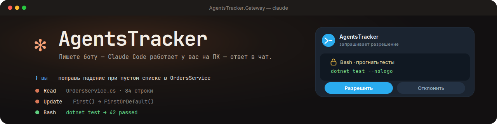
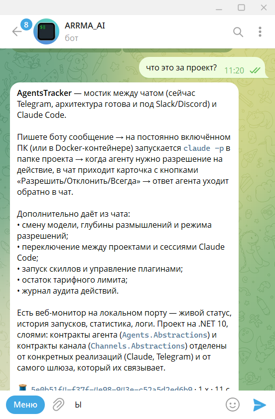
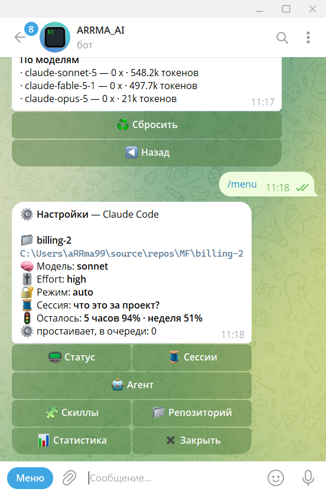
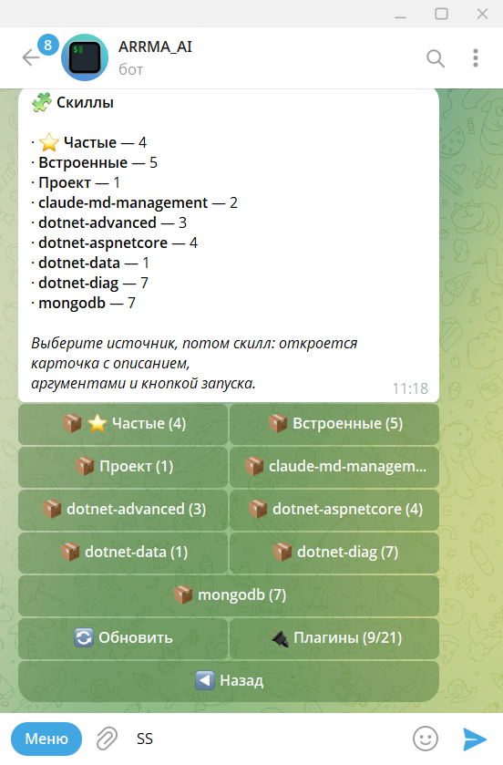
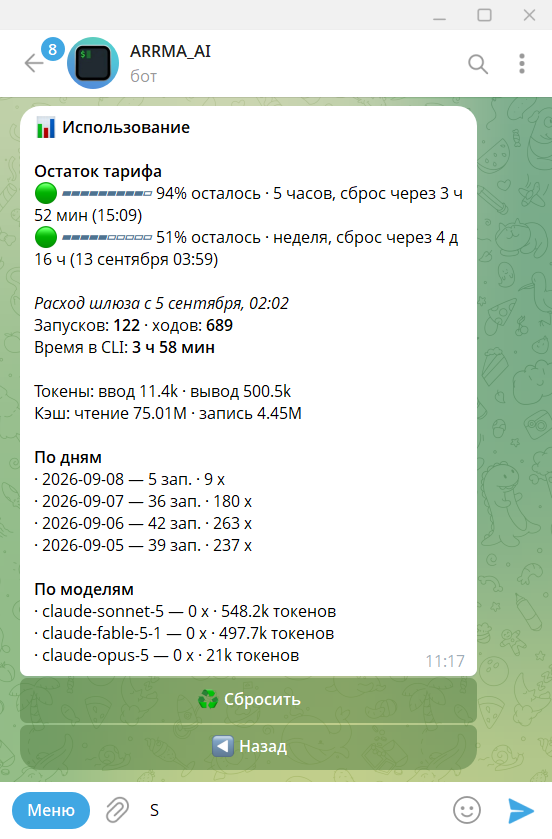
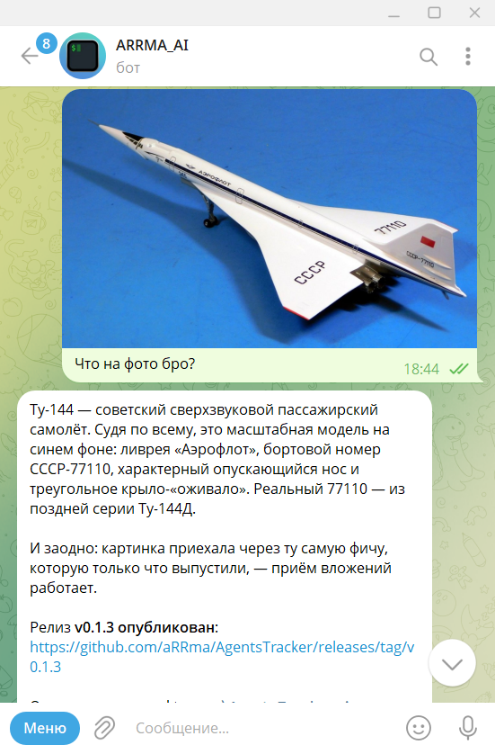
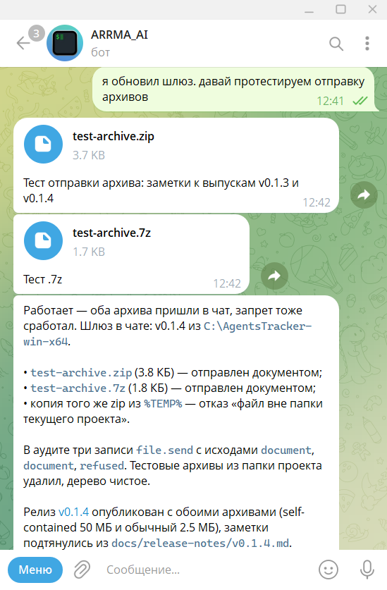
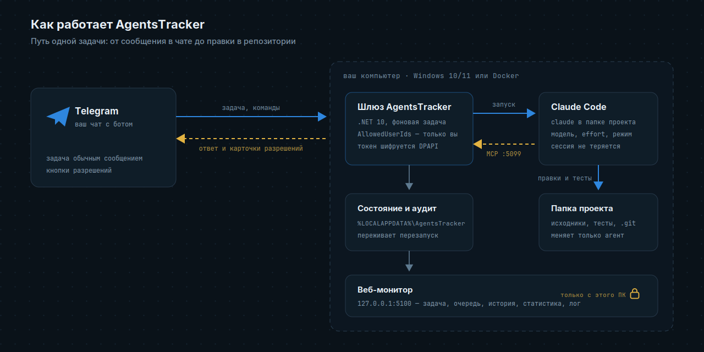
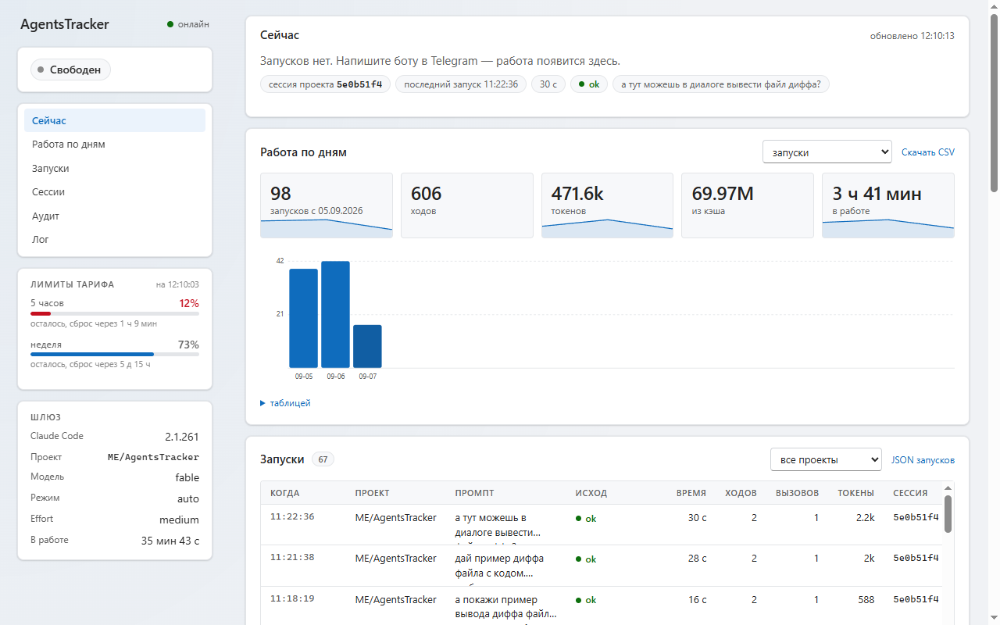

<h1 align="center">AgentsTracker</h1>

<p align="center">
  
</p>

<p align="center">
  Telegram-бот, через который вы ставите задачи Claude Code на своём компьютере.<br>
  Пишете боту — на ПК запускается <code>claude</code> в папке проекта — ответ приходит в чат.
</p>

<p align="center">
  
  
  
  
</p>

Каждое опасное действие агент подтверждает у вас кнопкой. Разговор не теряется между
сообщениями и перезапусками. Отчёт, разбор или скриншот агент присылает файлом в тот же чат.
Компьютер должен быть включён, белый IP не нужен.

## Как это выглядит

**Задача — обычным сообщением:**

> **Вы:** поправь падение при пустом списке в `OrdersService` и запусти тесты
>
> **Бот:** 🕐 Работаю… 0:42 · 🧵 5e0b51f4
> 🔧 3 вызова
> ▸ Читаю OrdersService.cs
> ▸ Правлю OrdersService.cs
>
> **Бот:** 🔐 **Bash** — запустить тесты
> `dotnet test --nologo`
> `[ ✅ Разрешить ]  [ ♾ Всегда ]  [ ❌ Отклонить ]  [ ✋ Отклонить с причиной ]`
>
> **Бот:** Причина — `First()` на пустой коллекции. Заменил на `FirstOrDefault` с проверкой,
> тесты зелёные: 42 passed.

**Живой чат:**

<table align="center">
  <tr>
    <td align="center" width="50%"><br><sub><b>Задача и ответ.</b> Спросили — агент прочитал проект и ответил</sub></td>
    <td align="center" width="50%"><br><sub><b><code>/menu</code>.</b> Проект, модель, effort, режим и сессия — кнопками</sub></td>
  </tr>
  <tr>
    <td align="center" width="50%"><br><sub><b><code>/skills</code>.</b> Скиллы по источникам и плагины Claude Code</sub></td>
    <td align="center" width="50%"><br><sub><b><code>/usage</code>.</b> Лимиты тарифа, расход по дням и моделям</sub></td>
  </tr>
  <tr>
    <td align="center" width="50%"><br><sub><b>Картинка в чат.</b> Прислали фото с подписью — агент посмотрел и ответил</sub></td>
    <td align="center" width="50%"><br><sub><b>Файлы из проекта.</b> Агент присылает отчёт или набор файлов архивом</sub></td>
  </tr>
</table>

## Не только код

Домашний компьютер знает про вас больше телефона: там документы, фотографии, выписки и заметки.
Обычно до них можно дотянуться, только сев за стол.

| Что спрашивают | Пример сообщения |
|---|---|
| **Забытый файл** — найти дома и прислать в чат, хоть по имени, хоть по тому, что внутри | «Найди скан загранпаспорта в Документах и пришли сюда» |
| **Домашняя бухгалтерия** — выписки, чеки и счётчики сводятся сами | «Сведи траты за квартал по категориям и пришли файлом» |
| **Заметки** — записать, найти в архиве, подвести итог недели | «Что я записывал про ремонт балкона?» |
| **Как дела дома** — место на диске, долгая выгрузка, домашний сервер | «Скачалось? Сколько осталось места на диске?» |
| **Фото в дело** — снимок чека или счётчика с подписью, что с ним сделать | фото чека: «занеси в расходы: дата, магазин, сумма» |

Подробнее, с примерами и настройкой, — [docs/use-cases.md](docs/use-cases.md); что бывает не так и
как это закрыть заранее — [docs/safety.md](docs/safety.md).

## Как устроено

<p align="center">
  
</p>

<p align="center">
  <sub>
    Всё живёт на вашей машине: наружу идут только исходящие запросы к Telegram и Anthropic —<br>
    белый IP и открытые порты не нужны. Разрешения агент спрашивает у шлюза по локальному порту.
  </sub>
</p>

## Веб-монитор

Страница на том же ПК — <http://127.0.0.1:5100/>. Она только показывает и ничего не меняет:
управление остаётся в чате, где есть список разрешённых пользователей и журнал.

На странице: статус (текущая задача, очередь, карточка в ожидании), расход по дням с графиком и
выгрузкой CSV, история запусков, расход по моделям, скиллы, сессии, журнал и лог. Слева —
состояние шлюза, лимиты тарифа шкалами, версия, модель и режим. Подробно — [docs/monitor.md](docs/monitor.md).

<p align="center">
  
</p>

## Быстрый старт

Готовое приложение со страницы [Releases](https://github.com/aRRma/AgentsTracker/releases):
скачать, заполнить три значения, поставить на автозапуск. Ни SDK, ни клона репозитория не нужно.

Команды везде даны двумя блоками: первый — PowerShell, второй — bash (Git Bash на Windows,
обычный терминал на macOS и Linux). Где команда одинакова, блок один.

### Что нужно

| | Проверка | Если нет |
|---|---|---|
| Windows 10/11 | — | на macOS и Linux пока только Docker |
| Claude Code | `claude --version` | PowerShell — `irm https://claude.ai/install.ps1 \| iex`, bash — `curl -fsSL https://claude.ai/install.sh \| bash`, открыть новое окно |
| Вход в Claude | `claude` стартует без просьбы войти | запустить `claude` и войти по подписке |
| Бот в Telegram | — | у [@BotFather](https://t.me/BotFather) команда `/newbot`, скопировать токен |
| Telegram доступен | PowerShell — `curl.exe -sI https://api.telegram.org`, bash — `curl -sI https://api.telegram.org` | указать `Proxy` в настройках |

Node.js не нужен. Git — по желанию: меню проектов ищет папки с `.git`, `*.sln`, `*.slnx`,
`package.json` или `pyproject.toml`.

### Какой архив взять

| Архив | Кому | Что нужно на машине |
|---|---|---|
| `AgentsTracker-<версия>-win-x64-self-contained.zip` (~50 МБ) | если сомневаетесь — этот | ничего, среда выполнения внутри |
| `AgentsTracker-<версия>-win-x64.zip` (~3 МБ) | если .NET уже стоит | [ASP.NET Core Runtime 10](https://dotnet.microsoft.com/download/dotnet/10.0) — именно ASP.NET Core, обычного .NET Runtime не хватит |

### Пять шагов

Внутри архива — папка `AgentsTracker-<версия>-…` с приложением и рядом с ней `install.txt`
с этой же инструкцией. По имени папки видно, какая версия установлена.

1. **Распакуйте** архив и перенесите папку приложения в постоянное место вне репозиториев,
   например `C:\Apps\AgentsTracker`: внутри репозитория её снесёт `git clean`.
2. **Настройки.** Рядом с exe скопируйте `appsettings.Local.example.json` как
   `appsettings.Local.json`, впишите `Channel:Settings:BotToken` и `ProjectPath`.
   `AllowedUserIds` пока оставьте как в примере: свой id вы узнаете на следующем шаге.
3. **Ваш id.** Запустите exe в консоли (`.\AgentsTracker.Gateway.exe` в PowerShell,
   `./AgentsTracker.Gateway.exe` в bash) и напишите боту что угодно — появится
   `Отклонено сообщение от постороннего пользователя. Пользователь: telegram:123456789`.
   Впишите номер (без имени канала) в `"AllowedUserIds": [ 123456789 ]` внутри
   `Channel:Settings` и закройте консоль по Ctrl+C.
4. **Поставьте на автозапуск:**
   ```powershell
   .\AgentsTracker.Gateway.exe install --start
   ```
   ```bash
   ./AgentsTracker.Gateway.exe install --start
   ```
   Задача Планировщика поднимет шлюз при входе в Windows, настройки переедут
   в `%LOCALAPPDATA%\AgentsTracker\`, токен зашифруется.
5. **Проверьте.** В чат придёт «🔌 Шлюз запущен» с версией, `/help` покажет команды,
   веб-монитор — <http://127.0.0.1:5100>.

Обновление: `uninstall` → распаковать новую папку приложения на место старой →
`install --start`. Снять всё — `uninstall`, настройки и история останутся.
Подробности — [docs/deployment.md](docs/deployment.md).

## Сборка из исходников

Нужен **.NET 10 SDK** (`dotnet --list-sdks` → строка `10.x`;
[скачать](https://dotnet.microsoft.com/download/dotnet/10.0) — именно SDK, не Runtime).
Остальное из «Что нужно» — так же.

Запуск для отладки: скопируйте `src/AgentsTracker.Gateway/appsettings.Local.example.json`
рядом как `appsettings.Local.json`, заполните его (шаги 2 и 3 выше) и выполните
`dotnet run --project src/AgentsTracker.Gateway`. Публикация и автозапуск из исходников —
в [docs/deployment.md](docs/deployment.md).

## Docker

Здесь агент видит только то, что вы смонтировали. Это же способ запустить шлюз на macOS и Linux,
пока для них нет своей установки.

```bash
cp .env.example .env                    # токен, свой id, папка с проектами (PowerShell: Copy-Item)
docker compose up -d --build
docker compose exec gateway claude      # один раз войти в аккаунт агента
```

Монитор публикуется на `127.0.0.1:5100` — пароля у него нет. Секреты живут в `.env`: DPAPI есть
только в Windows. Подробно — [docs/deployment.md](docs/deployment.md): порты, слои конфига,
проверка после установки, резервная копия, несколько экземпляров.

## Команды

| Команда | Что делает |
|---|---|
| любой текст | задача агенту |
| `/menu` | все настройки кнопками (то же самое — `/settings`) |
| `/status` · `/usage` | что происходит сейчас, включая заполненность контекста · расход и лимиты тарифа |
| `/new` · `/stop` | начать новую сессию · прервать запуск — и задачу, и вопрос |
| `/sessions` | сессии проекта: переключить, новая, остановить; видно, насколько заполнен контекст |
| `/ask <вопрос>` | вопрос вне сессии и проекта, отдельной моделью (sonnet). Идёт сразу, не ждёт задачи, приходит ответом на ваше сообщение. То же — кнопка «💬 Задать вопрос» в меню |
| «📦 Контекст» в `/menu` | из чего состоит контекст сессии, сжать его или начать новую сессию (с подтверждением) |
| `/agent` | модель, effort, режим (или `/model`, `/effort`, `/mode` текстом) |
| `/project` · `/skills` | сменить проект · скиллы и плагины Claude Code |
| `/rules` | правила «всегда», которые хранит шлюз; `/rules del <n>` и `/rules clear` снимают их. Правила агента лежат в `.claude/settings.local.json` проекта |
| `/audit` · `/help` | последние действия · справка (её же даёт `/start`) |

Под каждым ответом — подпись: сессия (или «💬 вопрос»), модель, которая на самом деле ответила,
с effort в скобках (`opus-5-5(H)`: L, M, H, XH, MAX — от low до max), число ходов и время.

## Подробнее

<details>
<summary><b>Перезапуск</b></summary>

Настройки читаются один раз при старте: поправили `appsettings.Local.json` — перезапустите.

Автозапуск:

```powershell
Stop-ScheduledTask -TaskName 'AgentsTracker Gateway'
Start-ScheduledTask -TaskName 'AgentsTracker Gateway'
```

```bash
schtasks //End //TN "AgentsTracker Gateway"
schtasks //Run //TN "AgentsTracker Gateway"
```

В контейнере: `docker compose restart`. Запуск из исходников перезапускают по
[docs/operations.md](docs/operations.md).

Если перезапуск пришёлся на работающую задачу, бот предупредит. Сделанное сохранено,
напишите «продолжай».

</details>

<details>
<summary><b>Основные настройки</b></summary>

Файл `appsettings.Local.json`, секция `Gateway`:

| Ключ | Зачем |
|---|---|
| `Channel:Type` | какой канал связи; пока только `telegram` |
| `Channel:Settings:BotToken` | токен от @BotFather |
| `Channel:Settings:AllowedUserIds` | кому можно управлять ботом |
| `Proxy`, `Channel:Settings:Proxy` | общий прокси машины · прокси только для канала (если нет — берётся общий) |
| `ProjectPath` | папка проекта по умолчанию |
| `Projects` / `ProjectsRoot` | какие папки показывать в меню выбора проекта |
| `Claude:Executable` | путь к `claude.exe`, если автопоиск не нашёл |
| `Claude:BuiltInSkills` | встроенные скиллы для `/skills`, строки `"/команда \| описание \| подсказка аргументов"` |
| `Model`, `Effort` | модель и effort по умолчанию |
| `PermissionMode` | что можно без спроса. Из чата переключаются `plan`, `default`, `acceptEdits`, `auto`; `dontAsk` и `bypassPermissions` — только здесь, в файле |
| `McpPort`, `MonitorPort`, `MonitorBind` | порт, по которому `claude` спрашивает разрешения (5099) · порт монитора (5100, `0` — выключить) · где слушать монитор: `loopback` или `any` для контейнера |
| `DataDirectory` | где хранить состояние и журнал. Задаётся в `appsettings.json` рядом с exe или переменной `Gateway__DataDirectory` |
| `ApprovalTimeoutMinutes`, `RunTimeoutMinutes` | сколько минут ждать ответа на карточку (15) и весь запуск (60) |
| `Attachments:Enabled`, `:MaxBytes`, `:RetentionHours` | картинки из чата: принимать ли (да), предел размера (10 МБ; Telegram отдаёт боту не больше 20 МБ), сколько часов хранить (24) |
| `Question:Model`, `Question:Effort` | модель и effort для `/ask`: по умолчанию `sonnet` и как решит Claude Code. Из чата не меняются |

Полный список — в `appsettings.json`.

</details>

<details>
<summary><b>Безопасность</b></summary>

Бот даёт доступ к командной строке вашего ПК. Поэтому:

- **обязательно** впишите свой id в `Channel:Settings:AllowedUserIds` — это единственная защита
  от посторонних. Пустой список — шлюз не запустится, сообщения чужих попадают в журнал;
- шлюз отвечает только в личных чатах, групповые игнорирует;
- после `install` (или `protect-secrets`) токен бота хранится зашифрованным (DPAPI): расшифрует
  только ваша учётная запись на этой машине. В контейнере DPAPI нет — там токен живёт в `.env`;
- порт для `claude` открыт только внутри ПК (`127.0.0.1`) и закрыт секретным токеном;
- веб-монитор тоже только на `127.0.0.1` и без пароля: его видит любой, кто вошёл на этот ПК.
  Он ничего не меняет; не нужен — `"MonitorPort": 0`. В контейнере публикуйте его как
  `127.0.0.1:5100:5100`, а не наружу;
- токены и пароли из команд попадают в журнал, лог и монитор как `***`;
- в проекте могут лежать настройки агента (`.claude/`, `.mcp.json`), которые он выполняет сам, без
  карточек. Перед первой задачей в таком проекте придёт карточка «Доверять проекту?», а после
  правки этих файлов — снова. Не доверяйте чужому проекту, пока не прочитали его
  `.claude/settings.json`;
- в Docker агент видит только смонтированные тома — это самый надёжный барьер из всех;
- полностью выключить подтверждения (`dontAsk`, `bypassPermissions`) из чата нельзя — только
  правкой файла на самой машине;
- агент присылает в чат файлы только из текущего проекта и только разрешённых типов (список — в
  [docs/safety.md](docs/safety.md)). Содержимое архива шлюз не разбирает. Секрет внутри проекта
  (`appsettings.Local.json`, копия `.env` под именем `.txt`) под это ограничение не попадает —
  держите секреты вне проекта;
- картинка из чата ложится в `inbox` папки данных, агенту открыта только папка этого чата. `/new`
  очищает её, а при старте шлюза удаляются файлы старше суток. Принимаются только PNG и JPEG:
  тип проверяется по содержимому;
- запретить что-то намертво можно в `.claude/settings.local.json` проекта:

  ```json
  { "permissions": { "deny": ["Bash(rm *)"] } }
  ```

  Кнопка «Всегда» такие запреты не обходит. Набор правил для всей машины и готовый файл —
  [docs/claude-permissions.md](docs/claude-permissions.md);
- правила «всегда» привязаны к проекту. `/rules` показывает только правила шлюза, а те, что
  записал сам агент, смотрите в `.claude/settings.local.json` проекта;
- «Плагины» в `/skills` правят ваш `~/.claude/settings.json` — то же, что `/plugin` в Claude Code;
- если команда или правка не влезла в карточку, перед ней приходит файл с полным текстом —
  не разрешайте, не заглянув.

Все риски и способы их закрыть — [docs/safety.md](docs/safety.md).

</details>

<details>
<summary><b>Если что-то не так</b></summary>

| Симптом | Причина |
|---|---|
| Скачанный exe не запускается, просит установить .NET | архив `…-win-x64.zip` работает только с ASP.NET Core Runtime 10 — поставьте его или возьмите `…-self-contained.zip` |
| `dotnet` не найден или «SDK 10.0 не установлен» | нет .NET 10 SDK; он нужен только при сборке из исходников |
| Бот молчит | в `Channel:Settings:AllowedUserIds` нет вашего id (в журнале — отклонённое сообщение), неверный токен или Telegram недоступен без прокси |
| `Gateway:BotToken больше не читается` | настройки канала переехали в `Gateway:Channel:Settings`; перенести — `pwsh -File scripts\migrate-channel-settings.ps1` (рядом останется `.backup`) |
| В меню не все проекты | не задан `ProjectsRoot`; список листается `◀ ▶` |
| `claude` не найден | не поставлен CLI или не открыто новое окно PowerShell; крайний случай — `Claude:Executable` |
| Агент просит войти в аккаунт | запустите `claude` в PowerShell и войдите; бот использует этот вход |
| Сборка падает с `MSB3021` | шлюз запущен и держит файлы. Установленный — `AgentsTracker.Gateway.exe uninstall` (снимает и останавливает), запущенный вручную — `Get-Process AgentsTracker.Gateway \| Stop-Process -Force` (в bash `taskkill //F //IM AgentsTracker.Gateway.exe`) |
| Кнопки не приходят | `PermissionMode` стоит `auto` — поставьте `default` |
| В логе кракозябры | консоль в cp866; смотрите лог в PowerShell |
| Монитор из контейнера не открывается | порт опубликован? внутри нужен `Gateway__MonitorBind=any` |

</details>

---

Детали эксплуатации, контракта с CLI и монитора — [docs/](docs/); там же устройство шлюза
([docs/architecture.md](docs/architecture.md)) и чек-листы, как добавить команду, экран, агента или
канал ([docs/extending.md](docs/extending.md)). Инструкции для самого агента —
[CLAUDE.md](CLAUDE.md) и `docs/en/`, они на английском.
